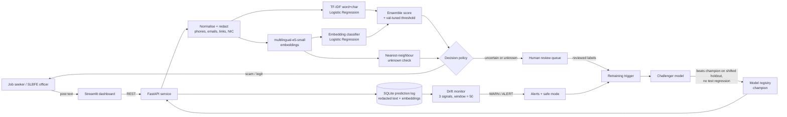

# JobShield LK

> Catches fake overseas-job offers today, and notices when recruitment scammers change tactics tomorrow.

**TensorForge 2.0 Final-Forge** · Theme: _Scam-Proof by Design_ · Licence: MIT

## Problem statement

JobShield LK detects fake overseas job offers and illegal recruiter posts in English, Sinhala and Singlish, to protect Sri Lankan migrant workers and their families from recruitment fraud, and flags when scammers change tactics (new destinations, fee tricks or channels) so suspect posts go to human review and retraining instead of slipping through.

## Impact statement

- **Who is protected:** Sri Lankan migrant workers (predominantly rural, first-time job seekers, youth pursuing high-salary corridors, and female domestic workers) and their extended families who finance foreign departures through pawned gold or debt.
- **How many people could be reached:** **~313,000 workers departed in 2024 alone**, representing a broader applicant pool of **1.2–1.5 million people annually**. Year 1 target: **100,000+ citizens reached** and **50,000+ job offers audited**.
- **Measurable harm prevented:** Avoids catastrophic losses of **LKR 150,000–1,500,000 per victim** (projected **> LKR 500M saved in Year 1**), eliminates high-interest debt traps/asset forfeiture, and prevents human trafficking into cyber-scam compounds.
- **Realistic path to adoption:** Phased rollout from a free citizen web/WhatsApp checker (Months 0–1) to SLBFE Special Investigation Unit (SIU) triage integration (Months 2–3), 25 District Office deployment (Months 4–6), and CBSL/CERT/Police partnerships (Months 7–12), running on a zero-marginal-cost CPU setup (< $15/mo).

See the full one-page impact brief in [IMPACT.md](IMPACT.md).

## What it does

1. **Detects:** paste a job post or message in English, Sinhala or Singlish and get a risk decision, a score and the warning signs found (upfront fee, guaranteed visa, chat-app-only contact, crypto/QR payment…).
2. **Logs** every prediction with privacy-safe redaction.
3. **Notices drift** with three signals over a sliding window: input distribution shift, falling confidence and a rising share of unknown inputs.
4. **Responds:** a safe fallback warning, a human-review queue, safe mode on alert, and a retraining trigger with a champion/challenger gate.

## Architecture



## How to run

**Requirements:** Python 3.12, about 2 GB of disk, CPU only. The first run downloads EMSCAD (50 MB) and `multilingual-e5-small` (470 MB).

### Windows (one command)

```powershell
powershell -ExecutionPolicy Bypass -File scripts\run.ps1
```

### Linux / macOS

```bash
bash scripts/run.sh
```

### Docker

```bash
docker build -t jobshield .
docker run -p 8000:8000 -p 8501:8501 jobshield
```

### Step by step

```bash
pip install -r requirements.txt
bash scripts/download_model.sh                     # optional: resumable model download
python -m jobshield.data.prepare                   # download EMSCAD, generate Sri Lankan posts, build splits
python -m jobshield.train --version v1 --promote   # train, evaluate, register champion
uvicorn jobshield.api:app --port 8000              # API -> http://localhost:8000/docs
streamlit run dashboard/app.py                     # dashboard -> http://localhost:8501
python scripts/drift_demo.py                       # optional: full drift loop without the server
```

### API

| Method | Path                                               | Purpose                                                                 |
| ------ | -------------------------------------------------- | ----------------------------------------------------------------------- |
| POST   | `/predict`                                         | `{"text": "..."}` → decision, score, confidence, warning signs, advice  |
| GET    | `/monitor/status`                                  | Drift level and the three signals with limits                           |
| GET    | `/monitor/recent`                                  | Recent logged predictions (redacted)                                    |
| GET    | `/monitor/alerts`                                  | Alerts and response events                                              |
| GET    | `/review/queue`                                    | Human-review queue                                                      |
| POST   | `/review/{id}`                                     | `{"label": 1 or 0}` reviewer decision                                   |
| POST   | `/retrain`                                         | Manually trigger a challenger                                           |
| GET    | `/model`                                           | Serving model, held-out metrics and registry                            |
| POST   | `/demo/stream`, `/demo/auto_review`, `/demo/reset` | Demo helpers: replay synthetic traffic and simulate reviewers           |

## Data

**No real personal data is used**, in line with Sri Lanka's PDPA No. 9 of 2022. Synthetic posts use masked phone numbers (`07X-XXXXXXX`), reserved `.example` links and invented agency names. Synthetic scam text is used only for training and testing and is never sent anywhere.

| Source                                                                                                                                                                                                                                                  | Licence / method                                                                                                                                       | Rows                                 |
| ------------------------------------------------------------------------------------------------------------------------------------------------------------------------------------------------------------------------------------------------------- | ------------------------------------------------------------------------------------------------------------------------------------------------------ | ------------------------------------ |
| **EMSCAD** (Employment Scam Aegean Dataset, University of the Aegean): real job ads with fraud labels. Hugging Face mirror [`victor/real-or-fake-fake-jobposting-prediction`](https://huggingface.co/datasets/victor/real-or-fake-fake-jobposting-prediction) | CC0-1.0                                                                                                                                                | 17,880 (866 fraudulent)              |
| **Sri Lankan overseas-job posts** in English, Sinhala and Singlish                                                                                                                                                                                      | Written by the team as component templates in [`jobshield/data/sl_generator.py`](jobshield/data/sl_generator.py), assembled with a fixed seed           | 2,000 current-era + 900 shifted-era  |
| **multilingual-e5-small** (pretrained encoder, not data)                                                                                                                                                                                                | MIT                                                                                                                                                    | –                                    |

### Splits

| Split                 | Contents                                                                                       | Purpose                                                 |
| --------------------- | ---------------------------------------------------------------------------------------------- | ------------------------------------------------------- |
| `train`               | EMSCAD 70% (stratified) + Sri Lankan current-era posts                                         | Model fitting                                           |
| `val`                 | EMSCAD 15% + Sri Lankan current-era posts                                                      | Threshold tuning, monitoring reference                  |
| **`test` (held-out)** | EMSCAD 15% + Sri Lankan posts built **only from sentences never seen in training**             | Reported results                                        |
| **`shifted`**         | 600 shifted-era Sri Lankan posts                                                               | Drift demo stream; reviewed labels feed retraining      |
| `shifted_holdout`     | ~300 other shifted-era posts                                                                   | Judging the retrained challenger (never trained on)     |
| `live_normal`         | 300 current-era posts                                                                          | Demo "normal traffic"                                   |

**Phrasing-disjoint test set:** every template pool is split so every fourth sentence is reserved for the test set. This stops the model from scoring well by memorising templates.

**The shifted set, or how scammers change tactics:**

1. New destinations: Israel, Japan, South Korea, Romania, Poland, Canada
2. New payment tricks: QR codes, USDT crypto, mobile wallets, "top up to activate your job account"
3. New channels: Telegram, TikTok DMs, application links
4. **Impersonating the official SLBFE programme notices**, then adding a payment trick
5. More Singlish and Sinhala, plus obfuscated spelling (`d3posit`, `W.h.a.t.s.A.p.p`, emojis)

## Evaluation results

_Filled in from `reports/metrics_v1.json` after training._

## Monitoring and drift response

### Prediction logging

Every prediction is written to SQLite (`artifacts/predictions.db`): time, hash, **redacted** text, language, score, decision, confidence, similarity to training data, unknown flag, warning signs, model version and embedding. The raw text is never stored. A service log is written to `artifacts/logs/service.log`.

### Drift signals (window = last 50 predictions)

| Signal                   | Type               | How it's computed                                                                       |
| ------------------------ | ------------------ | --------------------------------------------------------------------------------------- |
| Input distribution shift | input drift        | Cosine distance between the window's mean embedding and the reference centroid          |
| Mean confidence          | falling confidence | Average distance of scores from the decision threshold                                  |
| Unknown-input share      | unknown inputs     | Share of posts whose nearest training neighbour is less similar than 98% of normal posts |

**Limits are learnt, not guessed:** 1,000 bootstrapped windows of normal Sri Lankan validation traffic set each limit at the 99.5th percentile, plus a margin. One signal firing gives **WARN**; two or more give **ALERT**.

### Drift response

1. **Safe fallback:** uncertain or unfamiliar posts get a cautious "could not verify, treat as suspicious" message instead of a confident answer.
2. **Human review:** those posts go to a review queue in the dashboard.
3. **Safe mode on ALERT:** a wider review band, and any post that asks for payment is reviewed even if the model thinks it's fine.
4. **Retraining trigger:** during an alert, once 30 reviewed labels exist, a challenger is trained with them (5× weight).
5. **Champion/challenger gate:** the challenger is promoted only if F1 on the shifted holdout improves **and** F1 on the original test set drops by no more than 0.02. Otherwise the champion keeps serving and the rejection is logged.

## Repository layout

```
jobshield/
  data/download.py      EMSCAD download
  data/sl_generator.py  Sri Lankan post generator (current + shifted eras)
  data/prepare.py       splits
  features.py           normalisation, redaction, warning signs, language detection
  models.py             TF-IDF, embeddings, monitoring reference profile
  train.py              training + evaluation + reports
  service.py            prediction, decision policy, drift response, retraining
  monitoring/store.py   SQLite logs, review queue, alerts
  monitoring/drift.py   drift signals
  api.py                FastAPI app
dashboard/app.py        Streamlit dashboard
scripts/                run scripts, model download, drift demo
reports/                metrics and drift demo output
```

## AI tools used

- **Claude Code** (AI coding assistant) for code scaffolding, debugging and drafting documentation. All team members reviewed the code and can explain it.
- No LLM is used inside the product or for data generation.

## Templates reused

None. Everything was written during the build window.

## Licence

MIT
