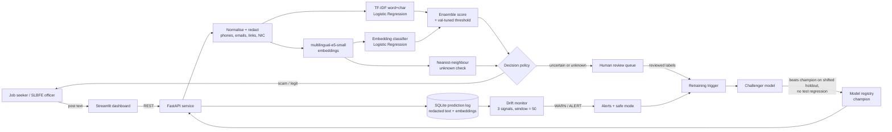

# JobShield LK

> Catches fake overseas-job offers today, and notices when recruitment scammers change tactics tomorrow.

**TensorForge 2.0 Final-Forge** · Theme: _Scam-Proof by Design_ · Licence: MIT

## Problem statement

JobShield LK detects fake overseas job offers and illegal recruiter posts in English, Sinhala and Singlish, to protect Sri Lankan migrant workers and their families from recruitment fraud, and flags when scammers change tactics (new destinations, fee tricks or channels) so suspect posts go to human review and retraining instead of slipping through.

## Who we protect

- **People looking for work abroad**, about 313,000 of whom left in 2024 alone. They answer "Korea / Israel / Europe / Gulf job" posts on Facebook, TikTok and WhatsApp.
- **Their families**, who borrow or pawn jewellery to pay the "agency fee", "visa fee" or "deposit".
- **First-time and rural job seekers** with no easy way to check whether an agency is licensed.

The full impact case is in [IMPACT.md](IMPACT.md).

## What it does

1. **Detects:** paste a job post or message in English, Sinhala or Singlish and get a risk decision, a score and the warning signs found (upfront fee, guaranteed visa, chat-app-only contact, crypto/QR payment…).
2. **Logs** every prediction with privacy-safe redaction.
3. **Notices drift** with three signals over a sliding window: input distribution shift, falling confidence and a rising share of unknown inputs.
4. **Responds:** a safe fallback warning, a human-review queue, safe mode on alert, and a retraining trigger with a champion/challenger gate.

## Architecture



## How to run

**Requirements:** Python 3.12, about 2 GB of disk, CPU only. The first run downloads EMSCAD (50 MB) and `multilingual-e5-small` (470 MB).

**The trained model is included.** `artifacts/models/v1.joblib` is the exact model behind the results below, so you can skip training and start serving straight away (`scripts\run.ps1 -SkipTrain` or `bash scripts/run.sh --skip-train`). Retraining from scratch takes about 20 minutes on a laptop CPU and reproduces it (fixed seeds).

### Windows (one command)

```powershell
powershell -ExecutionPolicy Bypass -File scripts\run.ps1
```

### Linux / macOS

```bash
bash scripts/run.sh
```

### Docker

```bash
docker build -t jobshield .
docker run -p 8000:8000 -p 8501:8501 jobshield
```

### Step by step

```bash
pip install -r requirements.txt
bash scripts/download_model.sh                     # optional: resumable model download
python -m jobshield.data.prepare                   # download EMSCAD, generate Sri Lankan posts, build splits
python -m jobshield.train --version v1 --promote   # train, evaluate, register champion
uvicorn jobshield.api:app --port 8000              # API -> http://localhost:8000/docs
streamlit run dashboard/app.py                     # dashboard -> http://localhost:8501
python scripts/drift_demo.py                       # optional: full drift loop without the server
python scripts/reset_demo.py                       # back to a clean demo state (stop the API first)
```

A separate web UI can be built against the API. Every endpoint, input and display field is listed in [docs/UI_SPEC.md](docs/UI_SPEC.md).

### API

| Method | Path                                               | Purpose                                                                 |
| ------ | -------------------------------------------------- | ----------------------------------------------------------------------- |
| POST   | `/predict`                                         | `{"text": "..."}` → decision, score, confidence, warning signs, advice  |
| GET    | `/monitor/status`                                  | Drift level and the three signals with limits                           |
| GET    | `/monitor/recent`                                  | Recent logged predictions (redacted)                                    |
| GET    | `/monitor/alerts`                                  | Alerts and response events                                              |
| GET    | `/review/queue`                                    | Human-review queue                                                      |
| POST   | `/review/{id}`                                     | `{"label": 1 or 0}` reviewer decision                                   |
| POST   | `/retrain`                                         | Manually trigger a challenger                                           |
| GET    | `/model`                                           | Serving model, held-out metrics and registry                            |
| POST   | `/demo/stream`, `/demo/auto_review`, `/demo/reset` | Demo helpers: replay synthetic traffic and simulate reviewers           |

## Data

**No real personal data is used**, in line with Sri Lanka's PDPA No. 9 of 2022. Synthetic posts use masked phone numbers (`07X-XXXXXXX`), reserved `.example` links and invented agency names. Synthetic scam text is used only for training and testing and is never sent anywhere.

| Source                                                                                                                                                                                                                                                  | Licence / method                                                                                                                                       | Rows                                 |
| ------------------------------------------------------------------------------------------------------------------------------------------------------------------------------------------------------------------------------------------------------- | ------------------------------------------------------------------------------------------------------------------------------------------------------ | ------------------------------------ |
| **EMSCAD** (Employment Scam Aegean Dataset, University of the Aegean): real job ads with fraud labels. Hugging Face mirror [`victor/real-or-fake-fake-jobposting-prediction`](https://huggingface.co/datasets/victor/real-or-fake-fake-jobposting-prediction) | CC0-1.0                                                                                                                                                | 17,880 (866 fraudulent)              |
| **Sri Lankan overseas-job posts** in English, Sinhala and Singlish                                                                                                                                                                                      | Written by the team as component templates in [`jobshield/data/sl_generator.py`](jobshield/data/sl_generator.py), assembled with a fixed seed           | 2,000 current-era + 900 shifted-era  |
| **multilingual-e5-small** (pretrained encoder, not data)                                                                                                                                                                                                | MIT                                                                                                                                                    | –                                    |

### Splits

| Split                 | Contents                                                                                       | Purpose                                                 |
| --------------------- | ---------------------------------------------------------------------------------------------- | ------------------------------------------------------- |
| `train`               | EMSCAD 70% (stratified) + Sri Lankan current-era posts                                         | Model fitting                                           |
| `val`                 | EMSCAD 15% + Sri Lankan current-era posts                                                      | Threshold tuning, monitoring reference                  |
| **`test` (held-out)** | EMSCAD 15% + Sri Lankan posts built **only from sentences never seen in training**             | Reported results                                        |
| **`shifted`**         | 600 shifted-era Sri Lankan posts                                                               | Drift demo stream; reviewed labels feed retraining      |
| `shifted_holdout`     | ~300 other shifted-era posts                                                                   | Judging the retrained challenger (never trained on)     |
| `live_normal`         | 300 current-era posts                                                                          | Demo "normal traffic"                                   |

**Phrasing-disjoint test set:** every template pool is split so every fourth sentence is reserved for the test set. This stops the model from scoring well by memorising templates.

**The shifted set, or how scammers change tactics:**

1. New destinations: Israel, Japan, South Korea, Romania, Poland, Canada
2. New payment tricks: QR codes, USDT crypto, mobile wallets, "top up to activate your job account"
3. New channels: Telegram, TikTok DMs, application links
4. **Impersonating the official SLBFE programme notices**, then adding a payment trick
5. More Singlish and Sinhala, plus obfuscated spelling (`d3posit`, `W.h.a.t.s.A.p.p`, emojis)

## Evaluation results

All numbers are on data the model never trained on. The decision threshold is tuned on the validation set (F1-optimal), never on test. Accuracy is not reported: only ~5% of EMSCAD ads are scams, so "always legit" would score 95%.

### Held-out test set (model v1)

| Model | Data | Precision | Recall | F1 | PR-AUC |
|---|---|---|---|---|---|
| TF-IDF baseline | EMSCAD (2,630 ads, 128 scams) | 0.858 | 0.805 | 0.831 | 0.912 |
| TF-IDF baseline | Sri Lankan posts, unseen phrasing (400, 197 scams) | 0.752 | 1.000 | 0.858 | 1.000 |
| Embedding (e5) | EMSCAD | 0.667 | 0.531 | 0.591 | 0.634 |
| Embedding (e5) | Sri Lankan posts | 0.990 | 1.000 | 0.995 | 1.000 |
| **Ensemble (served)** | **EMSCAD** | **0.861** | **0.773** | **0.815** | **0.860** |
| **Ensemble (served)** | **Sri Lankan posts** | **0.975** | **1.000** | **0.988** | **1.000** |
| **Ensemble (served)** | **All test (3,030)** | **0.934** | **0.911** | **0.922** | **0.957** |

The two models complement each other. TF-IDF is stronger on long English ads, while the embeddings remove most false alarms on Sinhala/Singlish posts (65 → 2). The ensemble keeps the best of both.

**Honest caveat:** the Sri Lankan posts are synthetic (template-built), so their scores are optimistic even with the phrasing-disjoint split. EMSCAD (real ads) is the more realistic number.

### Under drift (shifted holdout: 300 posts with tomorrow's tactics, 200 scams)

The shifted holdout is also **phrasing-disjoint**: it is built from shifted-era sentences that never appear in the drift stream the model is retrained on.

| Model | Precision | Recall | F1 |
|---|---|---|---|
| v1 ensemble (before) | 1.000 | **0.715** | 0.834 |
| Retrained challenger (after review + retraining) | 0.985 | **1.000** | **0.993** |

Without monitoring, v1 would silently miss **29% of new-tactic scams**. The retrained challenger catches them all, and its original test F1 also rises from 0.922 to 0.929.

### End-to-end drift demo (`python scripts/drift_demo.py` → `reports/drift_demo.json`)

| Phase | Drift status | Scams in phase | Model alone would call safe | Called safe by JobShield |
|---|---|---|---|---|
| 100 normal posts | 🟢 OK (8% sent to review) | 45 | 0 | 0 |
| 400 shifted posts | 🔴 ALERT (input shift 0.013 vs limit 0.004; unknown share 50% vs limit 10%; confidence fell 0.80 → 0.71 but stayed above its 0.69 limit) | 241 | **95 (39%)** | **0** (routed to review) |
| 282 reviewed labels → retrain → challenger **promoted** (test F1 0.922 → 0.929, shifted holdout F1 0.834 → 0.993) | | | | |
| 200 new shifted posts | 🟠 WARN (unknown share 50% → 0%) | 113 | **0** | **0** (review rate 5.5%) |

### What we learnt while building it (`reports/experiments/`)
- **Too few reviewed labels teach the wrong lesson.** With about 100 reviewed posts, the challenger learnt "SLBFE wording = scam" (because the new scams copy SLBFE notices) and flagged genuine licensed Sinhala agency posts (test F1 0.92 → 0.85). The champion/challenger gate **rejected** it. With 250–300 labels it learns the real signal (the payment trick) and passes. So retraining waits for 250 labels.
- **Review queues are biased towards hard cases.** During an alert we also send a random 30% of confident answers to reviewers (audit sampling), so retraining sees both sides.
- **Drift limits must be calibrated on realistic normal traffic.** Calibrating only on familiar phrasing caused false alarms on normal posts. Limits now come from a separate normal-traffic sample.

## Limitations and next steps

| Limitation | What we do now | Next step |
|---|---|---|
| **Sri Lankan posts are synthetic.** Template text is cleaner than real posts, so its scores are optimistic. | Real EMSCAD ads are reported separately (F1 0.82); test and holdout sets use unseen phrasing. | Collect real labelled posts through the SLBFE pilot. The review queue is that collection mechanism. |
| **23% of real fake ads are missed** (EMSCAD recall 0.77). | Borderline posts go to human review, not "legit"; warning signs are shown on every verdict. | Add EMSCAD metadata features (missing logo, company profile, salary); tune the threshold for recall. |
| **Retraining needs ~250 reviewed labels.** Fewer taught the wrong lesson. | Champion/challenger gate, audit sampling, retry after 100 more labels. | Active learning: ask reviewers about the most informative posts first. |
| **Scammers adapt** (spelling tricks, images). | Character n-grams, obfuscated text in the shifted set, per-post unknown-input check. | OCR for screenshot posts; regular red-team updates to the shifted set. |
| **Window-based drift needs ~25–50 posts** before an alert. | Each unfamiliar post is sent to review immediately, without waiting for the window. | Sequential tests (e.g. CUSUM) for faster alarms. |
| **No Tamil yet.** | The encoder supports Tamil and language detection recognises Tamil script. | Tamil templates and data. |
| **Long English ads are cut to 128 tokens** for the embedding model (CPU speed). | TF-IDF reads the full text; the ensemble combines both. | Chunked embeddings or a GPU. |
| **Demo reviewers are simulated** with synthetic ground truth. | Stated in the dashboard and here. | Real reviewers (SLBFE investigators) in the pilot. |

## Monitoring and drift response

### Prediction logging

Every prediction is written to SQLite (`artifacts/predictions.db`): time, hash, **redacted** text, language, score, decision, confidence, similarity to training data, unknown flag, warning signs, model version and embedding. The raw text is never stored. A service log is written to `artifacts/logs/service.log`.

### Drift signals (window = last 50 predictions)

| Signal                   | Type               | How it's computed                                                                       |
| ------------------------ | ------------------ | --------------------------------------------------------------------------------------- |
| Input distribution shift | input drift        | Cosine distance between the window's mean embedding and the reference centroid          |
| Mean confidence          | falling confidence | Average distance of scores from the decision threshold                                  |
| Unknown-input share      | unknown inputs     | Share of posts whose nearest training neighbour is less similar than 98% of normal posts |

**Limits are learnt, not guessed:** 1,000 bootstrapped windows of normal Sri Lankan validation traffic set each limit at the 99.5th percentile, plus a margin. One signal firing gives **WARN**; two or more give **ALERT**.

### Drift response

1. **Safe fallback:** uncertain or unfamiliar posts get a cautious "could not verify, treat as suspicious" message instead of a confident answer.
2. **Human review:** those posts go to a review queue in the dashboard.
3. **Safe mode on ALERT:** a wider review band, and any post that asks for payment is reviewed even if the model thinks it's fine.
4. **Retraining trigger:** during an alert, once 250 reviewed labels exist, a challenger is trained on the original data plus the reviewed posts. A random 30% audit sample of confident answers is also reviewed during alerts, to avoid only learning from hard cases. If a challenger is rejected, the next attempt waits for 100 more labels.
5. **Champion/challenger gate:** the challenger is promoted only if F1 on the shifted holdout improves **and** F1 on the original test set drops by no more than 0.02. Otherwise the champion keeps serving and the rejection is logged.

## Repository layout

```
jobshield/
  data/download.py      EMSCAD download
  data/sl_generator.py  Sri Lankan post generator (current + shifted eras)
  data/prepare.py       splits
  features.py           normalisation, redaction, warning signs, language detection
  models.py             TF-IDF, embeddings, monitoring reference profile
  train.py              training + evaluation + reports
  service.py            prediction, decision policy, drift response, retraining
  monitoring/store.py   SQLite logs, review queue, alerts
  monitoring/drift.py   drift signals
  api.py                FastAPI app
dashboard/app.py        Streamlit dashboard
scripts/                run scripts, model download, drift demo
reports/                metrics and drift demo output
```

## AI tools used

- **Claude Code** (AI coding assistant) for code scaffolding, debugging and drafting documentation.
- **ChatGPT** for an early model-training roadmap (saved as [`GPTrecomendation.txt`](GPTrecomendation.txt)) and for help with the exploration notebook in [`notebooks/`](notebooks/).
- All team members reviewed the code and can explain it.
- No LLM is used inside the product or for data generation.

## Templates reused

None. Everything was written during the build window.

## Licence

MIT
